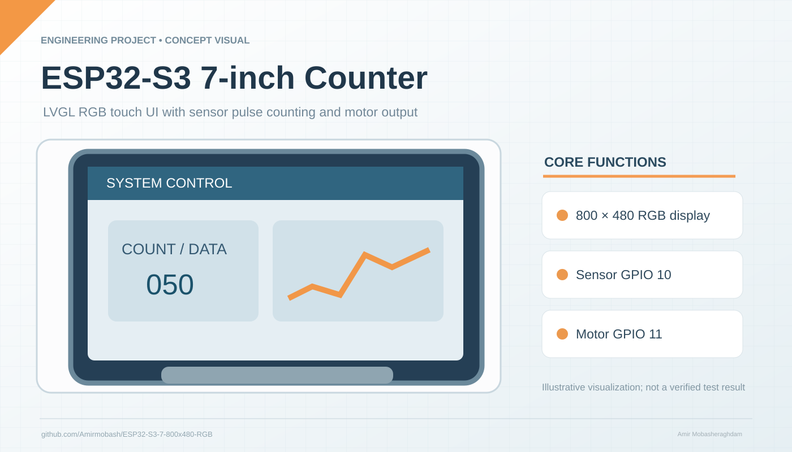

# ESP32-S3 7-inch RGB Touch Counter

Conceptual engineering illustration by Amir Mobasheraghdam; not a photograph of a tested unit.

## Overview

This Arduino sketch targets an **ESP32-S3** with an **800 × 480 RGB display**, **LVGL**, **LovyanGFX**, and optional **GT911 touch**. It provides a sensor pulse counter and a configurable motor control output.

## Source files

- `ESP32-S3.ino` — display bus setup, LVGL UI, pulse counting and state machine
- `lv_conf.h` — LVGL configuration
- `esp32-s3-touch-lcd-7.stp` — STEP mechanical reference file

## Pin assignments visible in source

- Sensor input: **GPIO 10** (interrupt input after PC817)
- Motor control: **GPIO 11** (requires appropriately rated MOSFET / SSR interface)
- Touch SDA: **GPIO 19**; SCL: **GPIO 20**

Verify all RGB bus pins, display model, touch wiring, power supply, motor interface, and electrical isolation against your actual hardware before connection. This repository has **not** been independently build-tested or hardware-validated in this documentation update.

## Attribution

Amir Mobasheraghdam.
